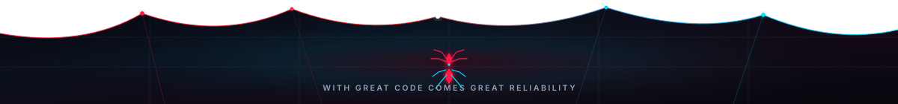

<!-- Spider-Man Themed Dynamic Header Banner -->

  

<!-- Subtitle / Typing Animation -->

  

<!-- Cyber Spider-Man Tactical HUD Social Buttons (Real Full-Color Official Logos) -->

  
  
  
  

 

---

### About

**ERP & Systems Integration Specialist · Odoo Developer** based in Indonesia.  
Focused on scalable enterprise architecture, multi-system integration, and operational workflow automation.

- **Odoo ERP & Custom Module Development:** Engineering tailor-made modules, automated business logic, custom ORM models, and ERP ecosystem integrations.
- **Centralized Monitoring & Data Hub:** Constructing real-time management dashboards for multi-system data synchronization, system monitoring, and analytics.
- **Enterprise ERP Administration:** System reliability engineering, database migrations, role-based access control (RBAC), query optimization, and production support.
- **Corporate Web & Digital Media:** Developing high-performance, responsive web applications and AI-accelerated digital media assets.

---

### Technical Stack

<table>
  <tr>
    <td align="left" width="28%"><b>Enterprise & Backend</b></td>
    <td>
      
      
      
      
    </td>
  </tr>
  <tr>
    <td align="left" width="28%"><b>Web Engineering</b></td>
    <td>
      
      
      
      
    </td>
  </tr>
  <tr>
    <td align="left" width="28%"><b>Creative & Media</b></td>
    <td>
      
      
      
      
    </td>
  </tr>
  <tr>
    <td align="left" width="28%"><b>Infrastructure & Operations</b></td>
    <td>
      
      
      
      
    </td>
  </tr>
</table>

---

### GitHub Activity & Statistics

  
  

 

  

 

  <picture>
    <source media="(prefers-color-scheme: dark)" srcset="https://raw.githubusercontent.com/WorkAkbar/WorkAkbar/output/github-contribution-grid-snake-dark.svg" />
    <source media="(prefers-color-scheme: light)" srcset="https://raw.githubusercontent.com/WorkAkbar/WorkAkbar/output/github-contribution-grid-snake.svg" />
    
  </picture>

---

### Core Focus Areas

| Domain | Scope & Responsibilities | Key Technologies |
| :--- | :--- | :--- |
| **ERP & Backend Architecture** | Custom Odoo modules, automated business logic, relational database modeling, and external API integrations | `Odoo (v14–v18)` · `Python` · `PostgreSQL` · `REST API` |
| **Web Engineering** | Centralized monitoring interfaces, real-time telemetry dashboards, and responsive corporate web applications | `TypeScript` · `React / Next.js` · `Tailwind CSS` · `Vite` |
| **Creative Suite & Digital Media** | Production of corporate video assets, 2D/3D visual graphics, and AI-accelerated multimedia workflows | `Adobe Suite` · `DaVinci Resolve` · `Blender` · `Generative AI` |
| **Enterprise Operations & Support** | Production reliability, database maintenance, role-based access control, and operational troubleshooting | `Linux` · `Docker` · `PostgreSQL` · `System Reliability` |

---

### Contact & Collaboration

Available for enterprise ERP consultations, multi-system integration initiatives, and technical collaborations.

  
  
  
  

<!-- Spider-Man Themed Dynamic Footer Banner -->

  

